# VideoStream

A self-hosted video streaming platform: upload a movie or a series episode, and it is converted to adaptive HLS streaming, then published to a Netflix-style website where each viewer has their own account, list and watch progress.

It is made of two applications on one backend:

- **The viewer website**: sign in, browse Movies, Series and Anime, watch with quality, audio-language and subtitle menus, and continue where you left off on any device.
- **The admin dashboard**: upload, follow encoding live, publish, organise series and seasons, set thumbnails, add subtitles, and manage processing jobs.

It runs fully on a laptop with no cloud account, and the same code runs on AWS (S3, SQS, ECS Fargate, DynamoDB, CloudFront).

<p align="center">
  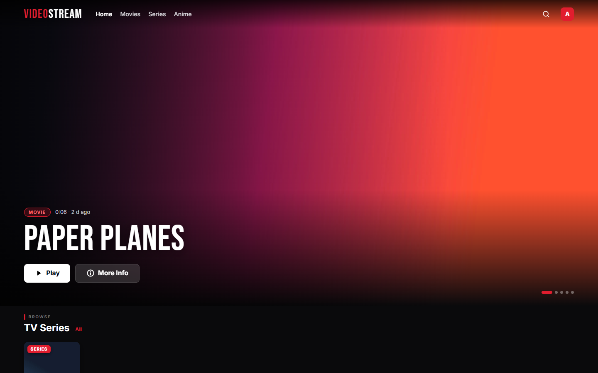
  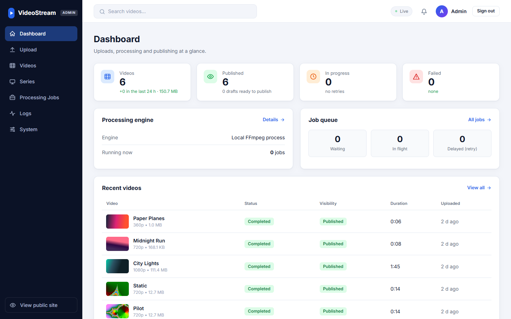
</p>

## Contents

- [Screenshots](#screenshots)
- [Features](#features)
- [Architecture](#architecture)
- [How a video flows through the system](#how-a-video-flows-through-the-system)
- [AWS deployment](#aws-deployment)
- [Tech stack](#tech-stack)
- [Getting started](#getting-started)
- [Configuration](#configuration)
- [Project structure](#project-structure)
- [API at a glance](#api-at-a-glance)
- [Documentation](#documentation)
- [Known limits](#known-limits)

## Screenshots

**Viewer website**

| Sign in | Browse |
|---|---|
| 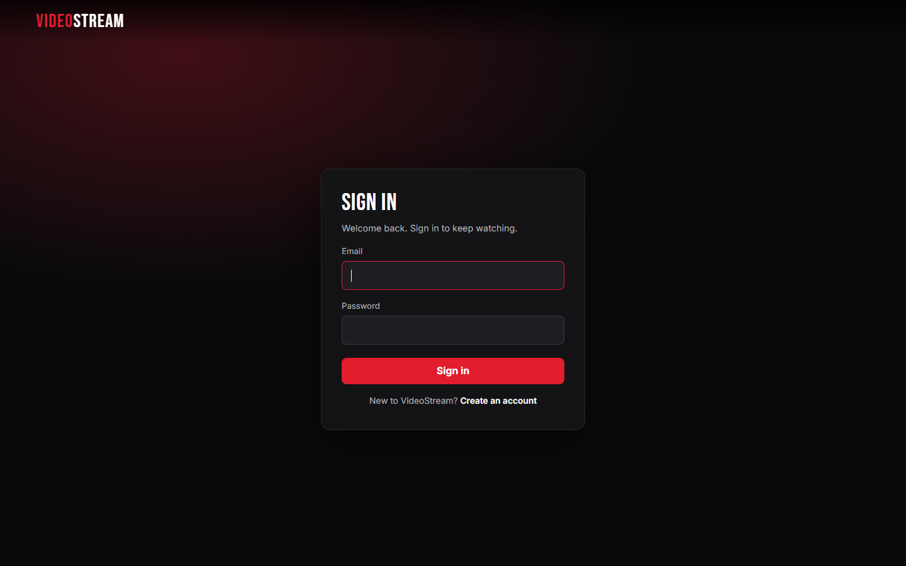 | 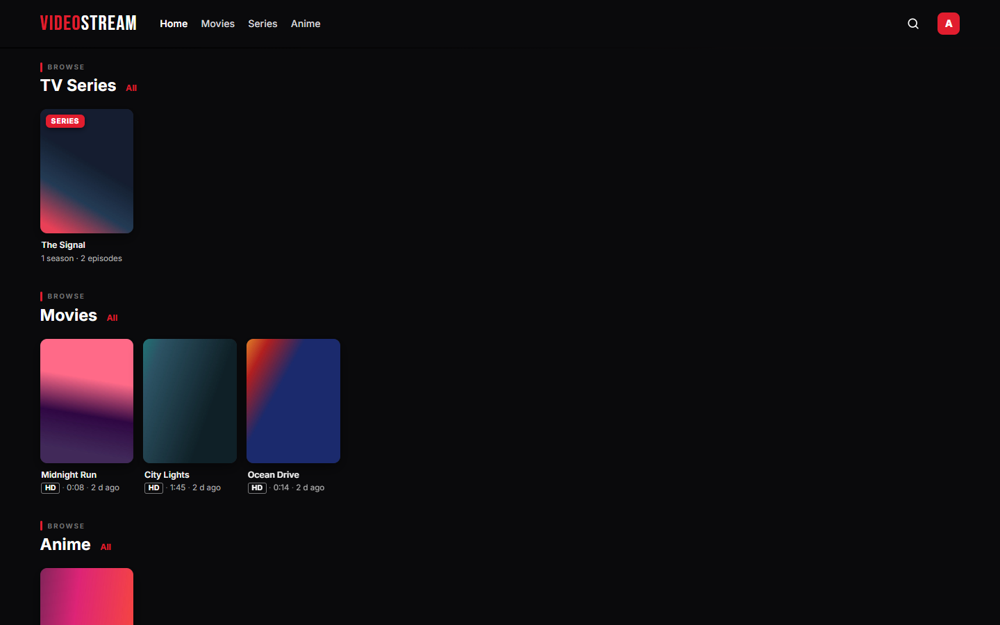 |
| **Watch**: quality, speed, audio language and subtitles | **A series** with its seasons and episodes |
| 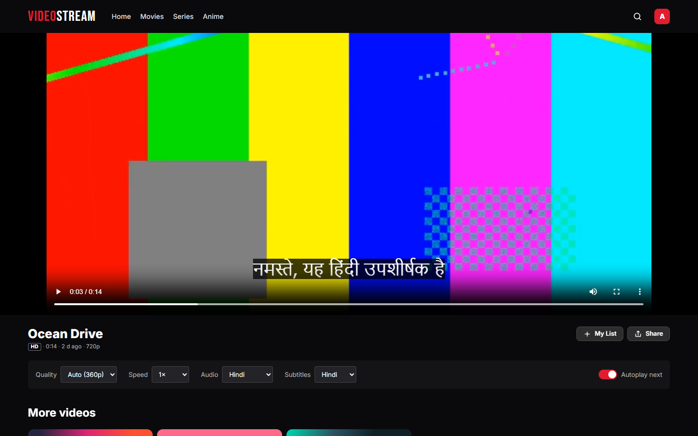 | 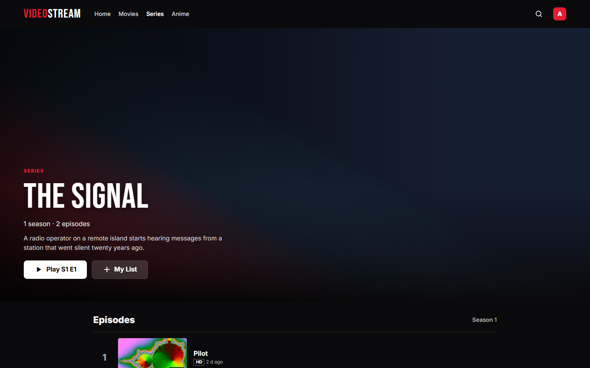 |

**Admin dashboard**

| Series and seasons | Audio languages and subtitles of a video |
|---|---|
| 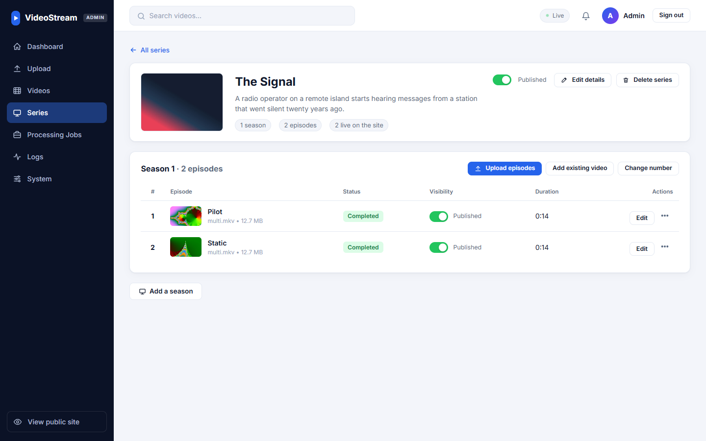 | 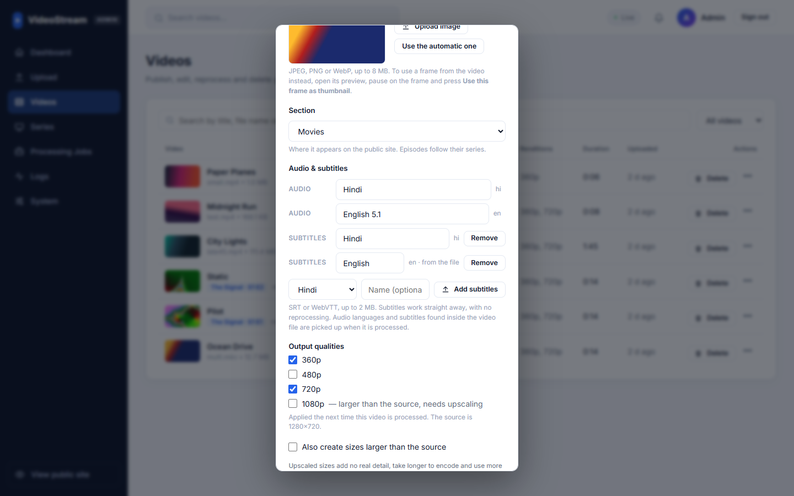 |

## Features

**For viewers**
- Accounts: sign up and sign in; nothing is visible without an account. Optional "Sign in with Google".
- Home page with a rotating hero, Continue Watching, TV Series, Movies, Anime and My List rows.
- Adaptive streaming (360p to 1080p) that follows the connection, with a manual quality choice.
- Audio menu for videos with several languages, and subtitles (from the file or uploaded by the admin).
- Resume from where you left off, next-episode countdown, playback speed, keyboard shortcuts.
- My List and watch history saved to the account, so they follow you to any device.

**For the admin**
- Upload large files (up to the configured limit) straight to storage, with live progress.
- Choose the output sizes per video; widescreen films get native sizes, upscaling is optional.
- Publish or unpublish, rename, pause, resume, reprocess, delete processed files, delete.
- Series with seasons and episodes, renumbering seasons, posters, and an Anime section.
- Thumbnails: upload an image, use a frame from the video, or the automatic one.
- Subtitles: add SRT or WebVTT per language, no re-encoding; rename audio and subtitle tracks.
- Dashboard, processing jobs, a processing log per video, system health, Prometheus metrics.

**Under the hood**
- One FFmpeg run decodes the source once and produces every size; constant-quality H.264 with bitrate caps; 8-bit output that every browser plays.
- Handles real-world files: audio that starts late, several audio languages, embedded subtitles, HEVC and 10-bit sources.
- Retries with back-off, a dead-letter queue, pause and stop that kill the encoder within seconds.
- The same code switches between local and AWS services with one setting (`PROVIDER`).

## Architecture

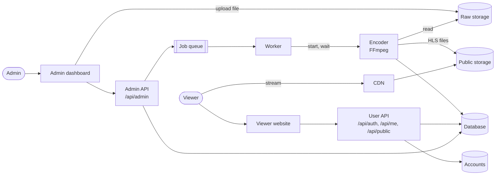

| Part | Role | Local | AWS |
|---|---|---|---|
| User API + website | Accounts, catalogue, My List, progress | Node process | Container on EC2 behind CloudFront |
| Admin API + dashboard | Uploads, publishing, jobs | Node process | Container on EC2 |
| Worker | Takes jobs from the queue, starts the encoder, retries | Node process | Container on EC2 |
| Encoder | FFmpeg for one video, then exits | Child process | ECS Fargate task, one per video |
| Raw / public storage | Original uploads / HLS output | Folders | S3 (private / via CloudFront) |
| Queue | "Process this video" jobs | JSON file | SQS + dead-letter queue |
| Database | Videos, series | JSON files | DynamoDB |
| Accounts | Viewers, My List, progress | JSON file | DynamoDB (own table) |

The API server runs as `APP_MODE=all` (both apps), `user` or `admin`. A user server has no admin routes at all, so the two can be deployed and firewalled separately. The design is explained in depth in **[docs/HLD.md](docs/HLD.md)**.

## How a video flows through the system

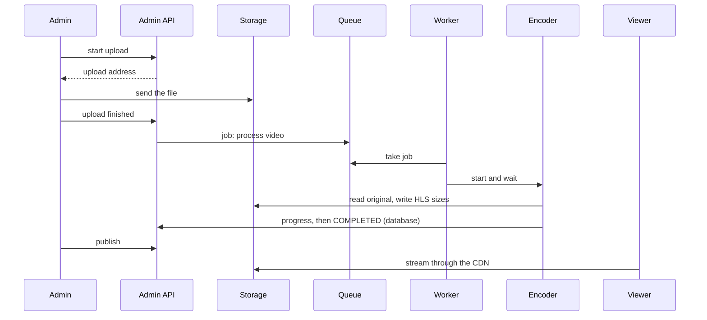

1. **Upload**: the file goes straight to raw storage (a presigned S3 URL on AWS), not through the server.
2. **Queue**: a job is added; the admin sees "Queued".
3. **Encode**: the worker starts one encoder per video and waits for it. `WORKER_CONCURRENCY` limits how many run at once.
4. **Output**: all sizes in 6-second segments, a master playlist, a poster, audio-language streams and subtitles.
5. **Publish**: once published (or automatically), the video appears on the viewer website and streams through the CDN.

## AWS deployment

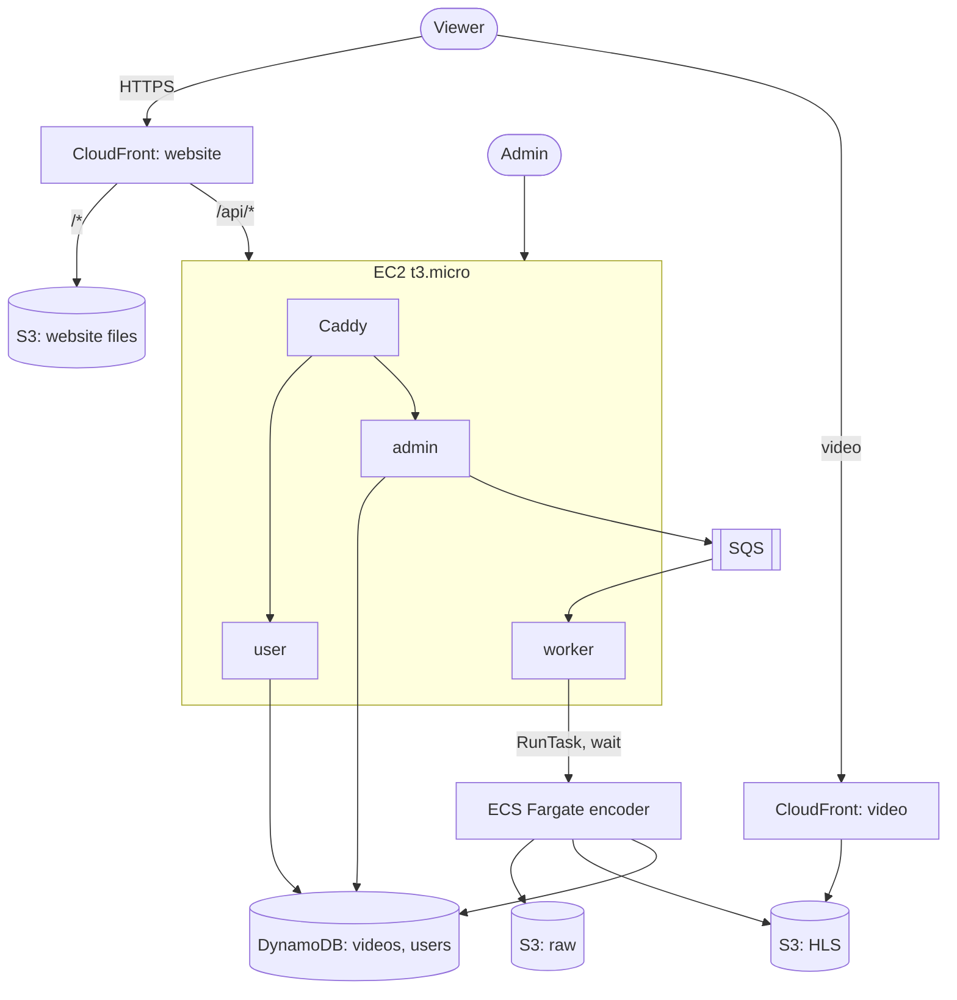

- One small always-on server runs the user app, the admin app and the worker; encoding runs on Fargate only while there is work, paid per second.
- Video is delivered by CloudFront from S3, never through the server.
- Everything is in `terraform/`. Step-by-step instructions: **[docs/DEPLOY_AWS.md](docs/DEPLOY_AWS.md)**.
- The viewer website's code also lives in its own repository, **[videostream-web](https://github.com/dineshuk01/videostream-web)**, deployed to S3 + CloudFront with `deploy.sh`.

## Tech stack

| Area | Used |
|---|---|
| Backend | Node.js 20, TypeScript, Express |
| Encoding | FFmpeg (H.264 + AAC, HLS) |
| Front-ends | Plain HTML, CSS and JavaScript (no build step), hls.js for playback |
| Cloud | AWS S3, SQS, ECS Fargate, DynamoDB, CloudFront, EC2, ECR |
| Infrastructure | Terraform, Docker, Caddy |
| Monitoring | Prometheus metrics, per-video processing log, live updates (Server-Sent Events) |

## Getting started

Requirements: Node.js 20+. FFmpeg comes with the project (`ffmpeg-static`), so nothing else is needed for local mode.

```bash
git clone https://github.com/dineshuk01/Video-Processing-System.git
cd Video-Processing-System
npm install
cp .env.example .env          # local mode is the default
```

Run the user site, the admin dashboard and the worker as separate processes:

```bash
npm run dev:split
```

| | Address |
|---|---|
| Viewer website | http://localhost:5000/ |
| Admin dashboard | http://localhost:5001/admin/ |

Or everything in one server: `npm run dev` (website at `/`, admin at `/admin/`) and `npm run dev:worker` in a second terminal.

Then open the admin, upload a video, publish it, create an account on the website and watch.

Set `ADMIN_API_KEY` in `.env` to protect the admin (without it the admin is open, for local development only).

## Configuration

The full list with explanations is in `.env.example`. The main settings:

| Setting | Purpose |
|---|---|
| `PROVIDER` | `local` or `aws` |
| `APP_MODE` | `all`, `user` or `admin` |
| `ADMIN_API_KEY` | Admin password |
| `USER_SESSION_SECRET` | Signs viewers' login cookies |
| `GOOGLE_CLIENT_ID` | Turns on "Sign in with Google" |
| `MAX_UPLOAD_SIZE_MB` | Largest upload |
| `WORKER_CONCURRENCY` | Videos encoded at the same time |
| `FFMPEG_PRESET`, `FFMPEG_CRF` | Encoding speed and quality |
| `CDN_BASE_URL` | CloudFront address for video files |

## Project structure

```
src/
  index.ts               API server (user and/or admin by APP_MODE)
  worker.ts              queue worker
  transcoderTask.ts      the encoder: FFmpeg, audio tracks, subtitles, upload
  routes/                public, account (auth + my data), admin, series, upload, live events, media
  services/              video rules, jobs, series, users, storage, queue, compute, database, thumbnails, subtitles
  middleware/            admin and viewer sign-in, rate limits
web/
  user/                  viewer website
  admin/                 admin dashboard
  shared/                helpers used by both
terraform/               AWS infrastructure (server, encoding, storage, database, CDNs, website)
scripts/run-split.js     starts the user app, admin app and worker
docs/                    design and deployment documents, screenshots
```

## API at a glance

| | Endpoints |
|---|---|
| Viewer accounts | `POST /api/auth/signup`, `/login`, `/logout`, `/google`; `GET /api/auth/me`, `/config` |
| Viewer data | `GET /api/me`; `PUT /api/me/list`; `PUT/DELETE /api/me/progress/:videoId` |
| Catalogue (signed in) | `GET /api/public/videos`, `/videos/:id`, `/series`, `/series/:id` |
| Admin | uploads, videos, publish, pause/resume/retry, thumbnails, subtitles, series and seasons, logs, queue, system: see [docs/HLD.md](docs/HLD.md#17-api-overview) |

Every response is `{ "success": true, "data": ... }` or `{ "success": false, "error": { "message", "code" } }`.

## Documentation

| Document | What it covers |
|---|---|
| [docs/HLD.md](docs/HLD.md) | High-level design: components, the life of a video, encoding, playback, data model, security, failure handling |
| [docs/ADMIN_AND_USER_APPS.md](docs/ADMIN_AND_USER_APPS.md) | The two applications, publishing, encoding settings, series, tracks, accounts |
| [docs/DEPLOY_AWS.md](docs/DEPLOY_AWS.md) | Deploying and updating on AWS with Terraform |

## Known limits

- Sizes stop at 1080p; a 4K upload is delivered at 1080p at most.
- One admin password, not per-person admin accounts.
- On AWS the video files are served by CloudFront without checking the viewer's session; a stream address that is passed on keeps working until signed CloudFront cookies are added (best done with a custom domain).
- Safari uses its own HLS player, without the custom quality and audio menus.
- No automated test suite in the repository yet.
