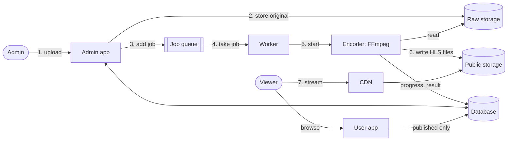
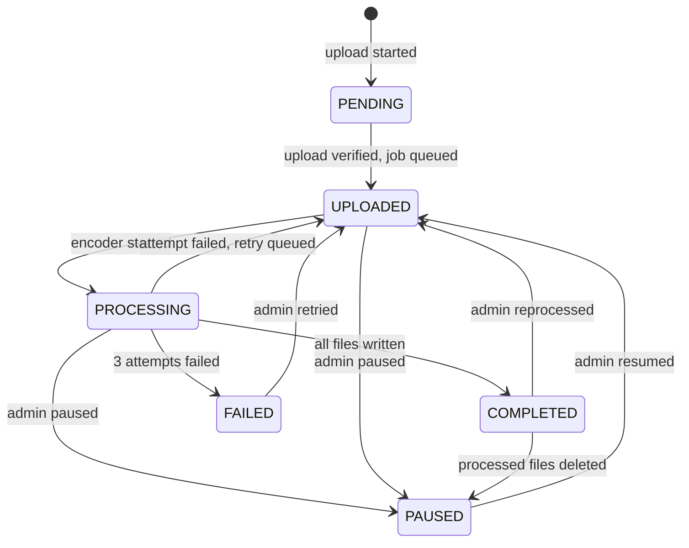
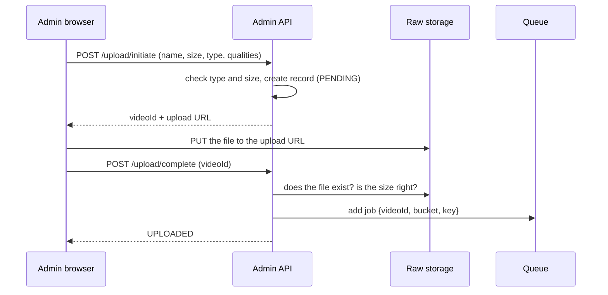
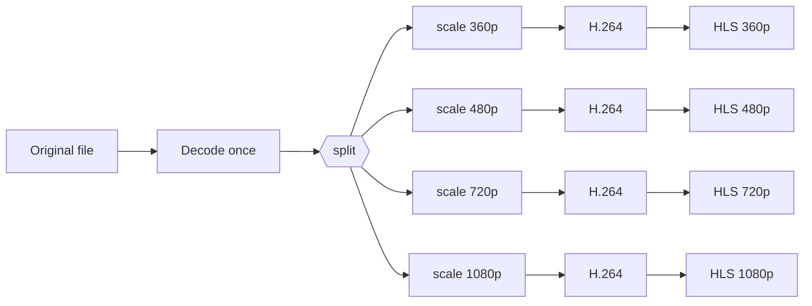
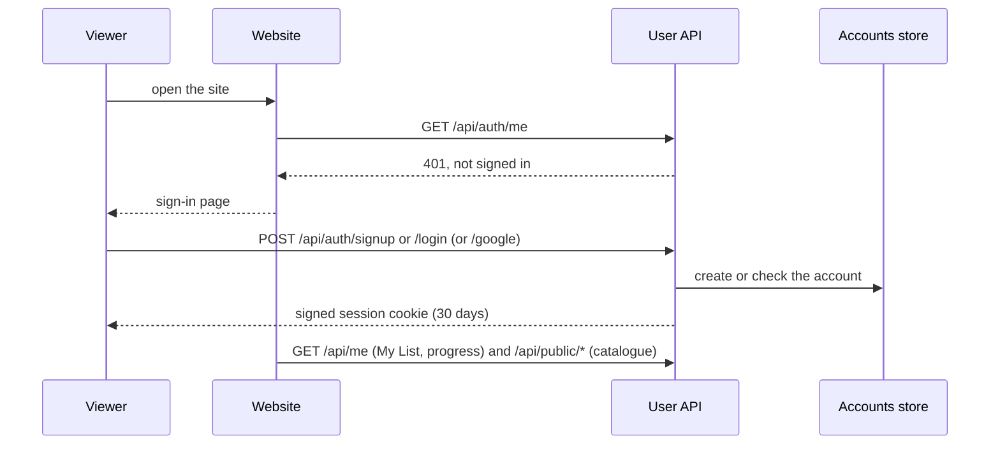
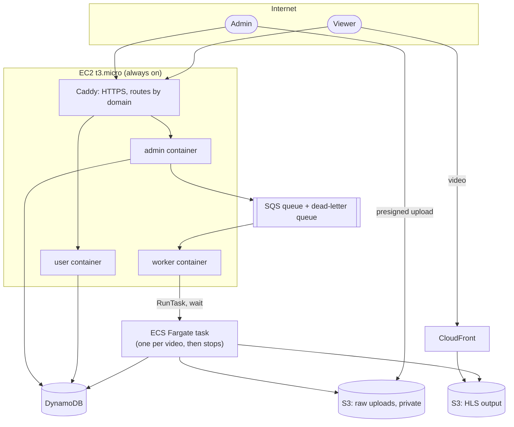

# VideoStream: High-Level Design

This document explains what the project is, how it is built, and what happens inside it from the moment an admin uploads a video to the moment a viewer watches it. It is written for someone who has not seen the code before.

- [1. What the project does](#1-what-the-project-does)
- [2. The big picture](#2-the-big-picture)
- [3. The two applications](#3-the-two-applications)
- [4. Building blocks](#4-building-blocks)
- [5. Local mode and AWS mode](#5-local-mode-and-aws-mode)
- [6. The life of a video](#6-the-life-of-a-video)
- [7. How encoding works](#7-how-encoding-works)
- [8. How playback works](#8-how-playback-works)
- [9. Data model](#9-data-model)
- [10. Series, seasons and sections](#10-series-seasons-and-sections)
- [11. Audio languages and subtitles](#11-audio-languages-and-subtitles)
- [12. Viewer accounts](#12-viewer-accounts)
- [13. Security](#13-security)
- [14. Failure handling](#14-failure-handling)
- [15. AWS deployment](#15-aws-deployment)
- [16. Code map](#16-code-map)
- [17. API overview](#17-api-overview)
- [18. Configuration](#18-configuration)
- [19. Known limits](#19-known-limits)

---

## 1. What the project does

VideoStream is a small video streaming platform, similar in shape to Netflix or YouTube but for one owner:

- An **admin** uploads video files (movies or episodes of a series).
- The system **converts** each file into a streaming format (HLS) in several sizes: 360p, 480p, 720p and 1080p.
- **Viewers** open a public website, browse Movies, Series and Anime, and watch. The player picks the size that fits their connection and switches as it changes.

The raw upload is never shown to viewers. They only ever see the converted output of videos the admin has published.

## 2. The big picture



In words:

1. The admin uploads a file through the admin app.
2. The original goes into **raw storage**. Nobody outside can read it.
3. A **job** ("process video X") is put on a **queue**.
4. A **worker** takes the job from the queue.
5. The worker starts an **encoder**, which runs FFmpeg.
6. The encoder writes the streaming files to **public storage** and reports progress to the **database**.
7. Once the admin publishes the video, viewers find it on the user app and stream the files through a **CDN**.

The queue is the important design choice. Uploading and encoding are separated, so a slow encode never blocks the website, several videos can wait their turn, and a failed job can be retried without the admin uploading again.

## 3. The two applications

One backend serves two separate front-ends.

| | User app | Admin app |
|---|---|---|
| Who uses it | Anyone | The owner only |
| Address | `/` | `/admin/` |
| API | `/api/public/*` | `/api/admin/*` |
| Sees | Published, finished videos | Everything: jobs, logs, errors, storage |
| Sign-in | None | Password (`ADMIN_API_KEY`) |

The setting `APP_MODE` decides what a server process offers:

- `all` (default): one process serves both.
- `user`: only the public site and `/api/public`. The admin routes do not exist on this process at all, so they answer 404 even to someone holding the password.
- `admin`: only the dashboard and `/api/admin`.

`npm run dev:split` starts the user app, the admin app and the worker as three processes (ports 5000 and 5001 by default). They share the same storage and database, which is how a rename or a publish in the admin shows up on the user site.

## 4. Building blocks

| Block | Job | Runs as |
|---|---|---|
| **API server** (`src/index.ts`) | Serves the two front-ends and the HTTP API | Long-running process |
| **Worker** (`src/worker.ts`) | Takes jobs from the queue, starts the encoder, handles retries | Long-running process |
| **Encoder** (`src/transcoderTask.ts`) | Runs FFmpeg for one video, then exits | One short-lived process per video |
| **Storage** | Keeps the original uploads (private) and the HLS output (public) | Folders locally, S3 on AWS |
| **Queue** | Holds "process this video" jobs | A JSON file locally, SQS on AWS |
| **Database** | Video records, series, logs | JSON files locally, DynamoDB on AWS |
| **CDN** | Delivers video files to viewers | The app itself locally, CloudFront on AWS |

The API server, worker and encoder are the same codebase started with different entry points. On AWS they are the same Docker image with a different start command.

## 5. Local mode and AWS mode

The setting `PROVIDER` switches every external dependency at once. The business code calls an interface; a small factory picks the implementation.

| Interface | `PROVIDER=local` | `PROVIDER=aws` |
|---|---|---|
| `StorageService` | Folders under `LOCAL_DATA_DIR` | Amazon S3 |
| `QueueService` | `queue/messages.json` | Amazon SQS |
| `ComputeService` | A child process on this machine | An ECS Fargate task |
| `DbService` | `db.json` | DynamoDB |
| Series store | `series.json` | The same DynamoDB table |
| Public URLs | `/api/local-s3/...` served by the app | CloudFront (`CDN_BASE_URL`) |

Because of this, the whole system runs on a laptop with no cloud account and no cost, and the same code runs on AWS.

Local files are shared between the API server and the worker, which are separate processes. Every change is a read-modify-write under a cross-process **file lock**, and files are replaced atomically (written to a temporary file, then renamed), so two processes cannot corrupt the data.

## 6. The life of a video

### 6.1 States



A separate flag, `published`, decides whether the public can see a `COMPLETED` video. With **auto-publish** on, it is set when processing finishes.

### 6.2 Upload



The file does not pass through the API on AWS: the browser sends it straight to S3 using a time-limited **presigned URL**. That keeps large uploads (up to `MAX_UPLOAD_SIZE_MB`) off the small server. Locally the same step goes to the app's own `/api/local-s3` route.

### 6.3 Processing

1. The worker asks the queue for a job. Taking a job hides it from other workers for a while (the **visibility timeout**).
2. The worker checks the record. A deleted, paused or already finished video is skipped and its job removed.
3. The worker starts the encoder and **waits** for it. Locally that is a child process. On AWS it is an ECS Fargate task, and the worker polls until the task stops.
4. The encoder downloads the original, runs FFmpeg, uploads the output, and writes progress and the result to the database.
5. The worker removes the job from the queue.

`WORKER_CONCURRENCY` is the number of jobs a worker handles at the same time. Because the worker waits for each encoder, this number is also the limit on how many encodes run at once.

### 6.4 Live progress

The admin dashboard opens one long-lived connection (`/api/admin/events`, Server-Sent Events). The server compares the database with its last snapshot on a short timer and pushes changes, so progress bars move without the page asking repeatedly. The user site does not need this; it refreshes its catalogue every 30 seconds and when the tab is opened again.

## 7. How encoding works

All sizes are produced in **one FFmpeg run**:



Decoding is a large part of the work (especially for HEVC sources), so decoding once instead of once per size saves a lot of time.

Key decisions:

| Decision | Why |
|---|---|
| **Constant quality** (CRF 17) with a peak bitrate cap per size | Detailed scenes get the bits they need; simple scenes do not waste storage |
| **8-bit output** (`yuv420p`) | Browsers cannot play 10-bit H.264, which 10-bit sources produce by default |
| **6-second segments**, keyframes aligned across sizes | The player can switch size at any segment boundary without a glitch |
| **Size classes** | "720p" means "at least 1280 wide or 720 tall", so a 1280×536 widescreen film gets a native 720p |
| **Aspect ratio kept** | A 2.39:1 film is fitted inside the 16:9 box, never stretched |
| **No upscaling by default** | Sizes larger than the source are skipped (and logged); the admin can opt in |
| **Preset `veryfast`** | A good balance of speed and file size; changeable with `FFMPEG_PRESET` |

The peak bitrate caps are 1.2, 2.5, 6 and 12 Mbps for 360p, 480p, 720p and 1080p.

**Progress** comes from FFmpeg's own position in the video (`-progress pipe:1`), mapped to 10–80% of the bar. The rest covers download, poster, subtitles and upload.

**Stopping**: while FFmpeg runs, the encoder checks the database every 1.5 seconds. If the admin paused or deleted the video, FFmpeg is killed, partial output is removed, and the encoder exits with a special code (3) that the worker treats as "stopped", not "failed".

### Output of one video

```
processed/<videoId>/
  master.m3u8              the list of available sizes (and audio languages)
  playlist_720p.m3u8       the list of segments for one size
  output_720p_000.ts ...   the video segments
  audio_0.m3u8, audio_0_000.ts ...   one audio stream per language (multi-audio files only)
  subs_0.vtt               subtitles found in the file
  poster.jpg               the automatic thumbnail
```

## 8. How playback works

HLS (HTTP Live Streaming) is plain files over HTTP:

1. The player loads `master.m3u8`, which lists the sizes and their bitrates.
2. It picks one and loads that size's playlist, which lists the segments.
3. It downloads segments one after another and feeds them to the browser's video element.
4. It measures download speed and switches to a larger or smaller size at the next segment.

The sites use **hls.js** to do this in Chrome, Firefox and Edge. The page waits for the library to load before starting, so the quality, audio and subtitle menus are always available.

The user player also: remembers where each video was left, offers "Continue watching", plays the next episode of a series after a short countdown, remembers the chosen speed, audio language and subtitle language, and has keyboard shortcuts.

On AWS the segments are served by **CloudFront**, which caches them close to viewers. The small server never handles video traffic.

## 9. Data model

### Video

| Field | Meaning |
|---|---|
| `id`, `originalName`, `title` | Identity; `title` is what viewers see |
| `status`, `progress`, `attempts`, `error` | Where it is in processing |
| `published`, `publishedAt`, `autoPublish` | Visibility on the public site |
| `qualities`, `allowUpscale`, `renditions` | Sizes asked for, and sizes actually made |
| `rawObjectKey` | Where the original is stored |
| `hlsPlaylistUrl`, `thumbnailUrl`, `customThumbnailKey` | Where the output and pictures are |
| `metadata` | Width, height, duration, codec, frame rate of the source |
| `seriesId`, `seasonNumber`, `episodeNumber` | Set when the video is an episode |
| `category` | `anime` when filed under Anime |
| `audioTracks`, `textTracks` | Audio languages and subtitles |
| `events` | The processing log shown to admins (last 200 lines) |

### Series

| Field | Meaning |
|---|---|
| `id`, `title`, `description` | Identity |
| `published` | An unpublished series hides all its episodes |
| `seasons` | Season numbers, including empty ones |
| `posterKey` | Optional poster; otherwise the first episode's thumbnail |
| `category` | `anime` when filed under Anime |

Episodes are ordinary videos that point at a series. There is no separate episode table.

### On DynamoDB

One table holds both kinds of item:

- key `id` = the video id, or `series#<id>` for a series
- an index on (`entity`, `createdAt`) lists all videos, or all series, newest first, without scanning the table

Video updates change only the fields given, so the encoder writing progress and the admin renaming a video do not overwrite each other. Series changes are written with a condition ("only if it has not changed since I read it") and retried on conflict.

## 10. Series, seasons and sections

- A **movie** is a video with no series.
- A **series** has seasons; each season has numbered episodes. Season 0 is for specials.
- An episode is visible to the public only when the episode is published **and** its series is published.
- A new series starts at Season 1, or another number the admin chooses. A season can be renumbered; its episodes move with it.
- The public site has three sections: **Movies**, **Series** and **Anime**. A movie or a series can be filed under Anime, and then appears there instead.

## 11. Audio languages and subtitles

**Several audio languages in one file.** The encoder finds every audio track. If there are two or more, each is rebuilt as stereo AAC and written as its own audio-only stream; the video sizes then carry no sound. The master playlist lists the languages, and the player shows an **Audio** menu. A file with one audio track is handled the simpler way, with sound inside each size.

**Audio that starts late.** Some files have no sound for the first part. Segments without any audio break playback in browsers, so the encoder first builds a gap-free audio track with silence at the start.

**Subtitles** reach the player's **Subtitles** menu from two places:

| Source | How |
|---|---|
| Inside the upload | Text subtitle streams (SRT, ASS, mov_text, WebVTT) are converted to WebVTT during processing. Picture-based subtitles cannot be converted and are skipped with a log line. |
| Uploaded by an admin | An `.srt` or `.vtt` file per language. SRT is converted to WebVTT. It works at once, with no reprocessing. |

Uploaded subtitles are stored under `subtitles/<videoId>/`, apart from the processed files, so reprocessing a video does not erase them.

## 12. Viewer accounts

Everything on the viewer website needs an account: the catalogue, the posters and (locally) the video files.



| Part | How |
|---|---|
| Sign-up and sign-in | Name, email and password; or "Sign in with Google" when `GOOGLE_CLIENT_ID` is set (passwords then turn off) |
| Passwords | Stored only as salted scrypt hashes |
| Session | A signed, HttpOnly cookie (`USER_SESSION_SECRET`) with no server-side session store; Secure when the visitor uses HTTPS |
| Google sign-in | The server checks Google's signature on the ID token, the audience, the expiry, and that the email is verified |
| Per-person data | My List and, per video, the position, last-watched time and "finished". This drives Continue Watching, resume and the history |
| Storage | `users.json` locally; on AWS a DynamoDB table of its own: key `USER#<email>`, items `PROFILE`, `LIST`, `PROGRESS#<videoId>` |
| Abuse | Sign-up and sign-in are limited to 20 attempts per 15 minutes per visitor; a wrong email and a wrong password get the same answer |

The website saves the playing position at most every 10 seconds, and when the tab is hidden or closed. Playback speed and the chosen audio and subtitle language stay in the browser.

## 13. Security

| Risk | Protection |
|---|---|
| Strangers watching | The catalogue, My List, progress and (locally) the media need a signed-in viewer account. |
| Strangers using admin functions | Every `/api/admin` route needs the admin password. The session is a signed, HttpOnly cookie; scripts can send an `x-admin-key` header. |
| Admin routes exposed on the public server | With `APP_MODE=user` they are not mounted at all. |
| Viewers reading unpublished or raw files | The public API returns published, finished videos only. Locally, the media route serves the public only the files of visible videos; raw uploads are admin-only. On AWS the raw bucket is private and the public bucket is readable only through CloudFront. |
| Internal details leaking | Public responses contain no job state, errors, storage keys or file sizes. |
| Fake file types | Uploaded images are identified by their first bytes, not by the header the client sends. |
| Path tricks | The local media route rejects paths that leave the storage folder. |
| Abuse of the public API | A rate limit (600 requests per 15 minutes per address). |

## 14. Failure handling

| What goes wrong | What the system does |
|---|---|
| The encoder fails | The worker re-queues the job with a growing delay (15 s, then 45 s). After 3 attempts the video is marked `FAILED`; the admin can retry it from the dashboard. |
| The worker crashes mid-job | The job becomes visible in the queue again after the visibility timeout, and is taken again. A job for a video that is already `COMPLETED` is dropped, so nothing is encoded twice. |
| AWS has no room for another encoding task | The worker waits and tries again, up to 45 minutes, instead of failing the video. |
| The admin pauses or deletes during an encode | The encoder stops within seconds and cleans up; this is not counted as a failure. |
| A video is reprocessed | Files are rewritten under the same names. The local media route tells browsers to re-check files, so an old copy is not replayed. |
| An upload is abandoned | A cleanup task removes raw uploads that were never processed after 24 hours (it runs every 6 hours). On AWS the raw bucket also deletes originals after 7 days. |

## 15. AWS deployment



- **One small server** runs the user app, the admin app and the worker as three containers behind Caddy. With domains set, Caddy gets and renews HTTPS certificates on its own.
- **Encoding runs only when there is work.** The worker starts one Fargate task per video and the task stops when it finishes, so compute is paid per second of encoding.
- **Video delivery** goes from S3 through CloudFront, not through the server.
- Everything is described in `terraform/`. The steps are in [DEPLOY_AWS.md](DEPLOY_AWS.md).

Cost shape: a small fixed part (the server) plus encoding time, storage, and data delivered to viewers. Delivery dominates once there are many viewers.

## 16. Code map

```
src/
  index.ts                 API server: mounts routes by APP_MODE, serves the two front-ends
  worker.ts                queue polling loops (WORKER_CONCURRENCY)
  transcoderTask.ts        the encoder: probe, FFmpeg, subtitles, master playlist, upload
  types.ts                 VideoRecord, Series, tracks, statuses
  routes/
    public.ts              /api/public: published videos and series
    admin.ts               /api/admin: overview, queue, system, logs, publish, thumbnails, subtitles, pause, retry
    adminSeries.ts         /api/admin/series: series, seasons, episodes, posters
    upload.ts              upload initiate / complete, list, get, delete
    events.ts              live updates (Server-Sent Events)
    localS3.ts             local stand-in for S3 and the CDN, with public/admin gating
    metrics.ts             Prometheus metrics
  middleware/              admin sign-in, rate limit, image body parsing
  services/
    video/                 videoService (business rules), jobProcessor (run + retry), publishedCache
    series/                series rules; JSON and DynamoDB stores
    db/                    DbService interface; JSON and DynamoDB implementations
    storage/               StorageService; local folders and S3; public URL builder
    queue/                 QueueService; local file and SQS
    compute/               ComputeService; local child process and ECS Fargate
    thumbnail/, subtitles/ image and subtitle handling
    cdn/, cleanup/, metrics/
  utils/                   file lock, JSON file store, languages, logger, response helpers
web/
  user/                    the viewer website (one page, hash routes); also kept in its own repo, videostream-web
  admin/                   the dashboard (app, upload, views, series)
  shared/common.js         helpers both sites use
terraform/                 the AWS infrastructure
scripts/run-split.js       starts user, admin and worker as separate processes
docs/                      this file, ADMIN_AND_USER_APPS.md, DEPLOY_AWS.md
```

The front-ends are plain HTML, CSS and JavaScript with no build step.

## 17. API overview

**Public** (`/api/public`)

| Method and path | Returns |
|---|---|
| `GET /videos` | Published movies |
| `GET /videos/:id` | One video, with episode links if it is an episode |
| `GET /series` | Published series with their seasons and episodes |
| `GET /series/:id` | One series |

**Admin** (`/api/admin`, sign-in required)

| Area | Endpoints |
|---|---|
| Sign-in | `POST /login`, `POST /logout`, `GET /session` |
| Upload | `POST /upload/initiate`, `POST /upload/complete` |
| Videos | `GET /videos`, `GET /videos/:id`, `PATCH /videos/:id`, `DELETE /videos/:id` |
| Lifecycle | `POST /videos/:id/publish`, `/pause`, `/resume`, `/retry`, `/delete-processed` |
| Thumbnails | `POST /videos/:id/thumbnail`, `POST /videos/:id/thumbnail/frame`, `DELETE /videos/:id/thumbnail` |
| Tracks | `POST /videos/:id/subtitles`, `DELETE /videos/:id/subtitles/:trackId`, `PATCH /videos/:id/tracks/:trackId` |
| Series | `GET/POST /series`, `GET/PATCH/DELETE /series/:id`, `POST/DELETE /series/:id/poster` |
| Seasons and episodes | `POST /series/:id/seasons`, `PATCH/DELETE /series/:id/seasons/:number`, `POST /series/:id/episodes`, `POST/DELETE /videos/:id/series` |
| Monitoring | `GET /overview`, `/queue`, `/system`, `/logs`, `/videos/:id/logs`, `GET /events` |

Every response has the same shape: `{ "success": true, "data": ... }` or `{ "success": false, "error": { "message", "code" } }`.

## 18. Configuration

| Setting | Purpose |
|---|---|
| `PROVIDER` | `local` or `aws` |
| `APP_MODE` | `all`, `user` or `admin` |
| `PORT`, `USER_PORT`, `ADMIN_PORT` | Where each server listens |
| `ADMIN_API_KEY` | The admin password |
| `USER_APP_URL` | Where the admin's "View public site" link points |
| `MAX_UPLOAD_SIZE_MB`, `ALLOWED_MIME_TYPES` | Upload limits |
| `LOCAL_DATA_DIR`, `LOCAL_S3_*`, `LOCAL_SQS_QUEUE_NAME` | Local mode storage and queue |
| `AWS_REGION`, `AWS_S3_*`, `AWS_SQS_QUEUE_URL`, `DYNAMODB_TABLE_NAME` | AWS resources |
| `ECS_CLUSTER_NAME`, `ECS_TASK_DEFINITION`, `ECS_CONTAINER_NAME`, `ECS_SUBNETS`, `ECS_SECURITY_GROUPS` | The encoding task |
| `CDN_BASE_URL` | CloudFront address for video URLs |
| `WORKER_CONCURRENCY` | Videos encoded at the same time |
| `FFMPEG_PRESET`, `FFMPEG_CRF` | Encoding speed and quality |

See `.env.example` for the full list with comments.

## 19. Known limits

- **One admin password**, not per-person accounts or roles.
- **Sizes stop at 1080p.** A 4K upload is delivered at 1080p at most.
- **Reprocessing on AWS** rewrites files under the same names, so CloudFront can serve the old ones until its cache expires.
- **Originals are removed after 7 days on AWS.** After that a video still plays, but it cannot be reprocessed or have a new frame picked as its thumbnail.
- **Restarting the worker during an encode** loses track of that job until the queue shows it again; the encode itself continues and completes.
- **Safari** uses its own HLS player, without the custom quality and audio menus.
- **No automated test suite** is included in the repository.
